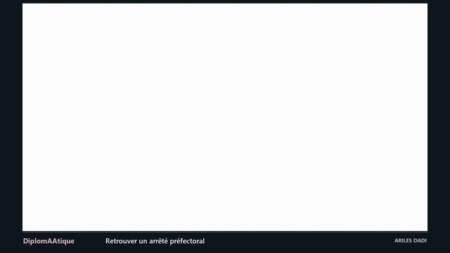

# DiplomAAtique - Extraction d’arrêtés administratifs

Projet universitaire réalisé en équipe, avec des tâches partagées entre traitement du texte, structuration des données et application web.

DiplomAAtique aide à retrouver un arrêté dans les recueils administratifs d’une préfecture. Le programme sépare les arrêtés et organise leurs informations pour les rendre consultables dans une interface web.

L’application permet de :
- Rechercher un arrêté par mots-clés dans les titres et les textes.
- Filtrer les résultats par préfecture, année ou date de publication.
- Ouvrir une fiche pour consulter les articles et les informations de l’arrêté.

**Outils :** Python, expressions régulières, SQLite et Flask.

## Aperçu du projet

L’application utilise la base universitaire d’origine : **19 595 arrêtés et 74 640 articles** extraits des recueils administratifs, également visibles dans la vidéo.

## Télécharger et lancer

1. Installe [Python 3.14](https://www.python.org/downloads/) si besoin, en cochant **Add python.exe to PATH**.
2. [Télécharge le projet en ZIP](https://github.com/ArilesD/diplomaatique/archive/refs/heads/main.zip), fais **Extraire tout**, puis ouvre le dossier extrait.
3. Double-clique sur **LANCER.cmd**.

Le premier lancement nécessite Internet pour installer les bibliothèques. Garde la fenêtre de lancement ouverte pendant l’utilisation et appuie sur **Entrée** dans cette fenêtre pour arrêter le projet.

Le lancement télécharge et prépare automatiquement la base originale. Recherche par exemple **vidéoprotection**, puis ouvre un résultat pour consulter ses articles. Les ouvertures suivantes réutilisent la base installée.

## Comment fonctionne le projet

1. Le programme lit un texte déjà issu de l’OCR et les informations du recueil.
2. Il repère et sépare les arrêtés.
3. Il extrait les informations et les articles en JSON.
4. L’application importe les résultats dans SQLite pour permettre la recherche.

## Comprendre les fichiers

| Fichier ou dossier | Rôle |
| --- | --- |
| `LANCER.cmd` et `lancer.py` | Préparent la base et démarrent l’application. |
| `donnees.py` et `donnees.json` | Téléchargement et provenance de la base originale. |
| `diplomaatique.py` | Lance le traitement du recueil. |
| `cleaner.py` et `arrete_separate.py` | Nettoient le texte et séparent les arrêtés. |
| `extractors/` | Règles d’extraction des informations. |
| `app.py`, `controllers/`, `models/` et `views/` | Recherche et interface web. |
| `exemple/` et `tests/` | Recueil administratif original et vérification de l’extraction. |
